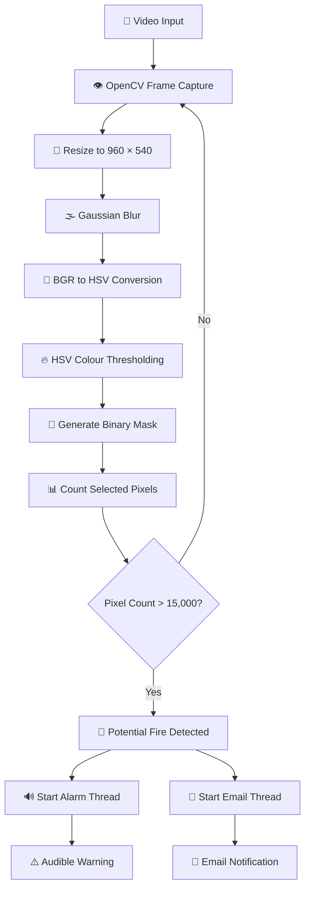

# 🔥 Fire Detection and Alarm System | Computer Vision-Based Fire Detection

<p align="center">
  
  
  
  
  
</p>

## 📌 Project Overview

**Fire Detection and Alarm System** is a Python-based computer vision project designed to identify potential fire-like regions in video footage and activate automated warning mechanisms.

The system uses OpenCV and NumPy to process video frames, analyse colour information in the HSV colour space, and identify regions that match predefined fire-like colour thresholds.

When the detected pixel count exceeds a specified threshold, the application activates an audible alarm and initiates email notifications using Python's SMTP functionality.

The project explores the practical application of image processing, computer vision, multithreading, and automated notification systems in fire hazard monitoring.

🎓 **Academic Project:** ISMT College – Expo 2.0

🎤 **Role:** Project Presenter

🔥 **Domain:** Computer Vision and Fire Detection

💻 **Application:** Python-Based Detection and Alert System

## 🎯 Project Objectives

- 🔥 Develop a computer vision-based fire detection prototype.
- 🎥 Analyse video frames to identify potential fire regions.
- 🎨 Apply HSV colour-space analysis for fire-like region identification.
- ⚙️ Implement image preprocessing techniques.
- 🧮 Use pixel-count thresholding for detection decisions.
- 🔊 Activate an audible alarm when a potential fire is detected.
- 📧 Implement automated email notifications.
- 🧵 Use multithreading for independent alert processing.
- 🎤 Demonstrate practical computer vision applications at ISMT College Expo 2.0.

## 💡 Problem Statement

Fire incidents can cause serious damage to property, infrastructure, and human life.

Early identification of potential fire hazards is important for initiating timely warnings and emergency responses.

This project explores a computer vision-based approach that analyses video footage to identify fire-like colour regions and activates warning mechanisms when predefined detection conditions are met.

## ✨ Key Features

### 🎥 Video Processing
- Read prerecorded video files using OpenCV.
- Capture and process individual video frames.
- Resize frames to improve processing efficiency.
- Display processed detection results.

### 🎨 Image Processing
- Apply Gaussian Blur to reduce image noise.
- Convert BGR images into HSV colour space.
- Define colour thresholds for fire-like regions.
- Generate binary masks using OpenCV.
- Extract candidate fire-coloured pixels.

### 🔥 Fire Detection Logic
- Analyse the number of detected fire-like pixels.
- Compare pixel counts against a predefined threshold.
- Trigger the alert mechanism when the threshold is exceeded.

### 🔊 Audible Alarm System
- Integrate an MP3 alarm sound.
- Automatically activate the alarm when a potential fire is identified.
- Run alarm playback in a separate thread.
- Use status flags to control alarm activation.

### 📧 Automated Email Notifications
- Integrate Python SMTP functionality.
- Configure Gmail SMTP communication using TLS.
- Support multiple notification recipients.
- Generate predefined fire incident notification messages.
- Execute email processing in a separate thread.

### 🧵 Multithreading
- Separate alarm playback from video processing.
- Run email notification tasks independently.
- Reduce blocking during alert processing.

### 🧹 Resource Management
- Handle keyboard interruption.
- Release video resources.
- Close OpenCV windows.
- Implement exception handling for unexpected errors.

## 🛠️ Technology Stack

| Technology | Purpose |
|---|---|
| 🐍 Python | Main programming language |
| 👁️ OpenCV | Video processing and image analysis |
| 🔢 NumPy | Image-array operations |
| 🎨 HSV Colour Space | Fire-like colour identification |
| 🌫️ Gaussian Blur | Noise reduction |
| 🔔 Playsound | Audible alarm playback |
| 📧 SMTP | Email notification |
| 🧵 Threading | Concurrent alert processing |
| 📁 OS Module | File and path management |
| 📊 Mermaid | System workflow documentation |
| 🗂️ GitHub | Source code management |

## 🔬 Technical Methodology

### 1️⃣ Video Input

The system uses OpenCV's `VideoCapture()` functionality to read video frames from a prerecorded video file.

### 2️⃣ Frame Resizing

Each frame is resized to:

- Width: 960 pixels
- Height: 540 pixels

This helps standardise the processing dimensions.

### 3️⃣ Image Smoothing

Gaussian Blur is applied using a 21 × 21 kernel to reduce image noise and small variations.

### 4️⃣ Colour Space Conversion

The BGR image is converted into HSV (Hue, Saturation, Value) colour space.

HSV colour representation allows the application to define colour ranges for identifying fire-like regions.

### 5️⃣ Colour Thresholding

The application uses the following HSV threshold values:

| Parameter | Value |
|---|---|
| Lower HSV | [18, 50, 50] |
| Upper HSV | [35, 255, 255] |

### 6️⃣ Binary Mask Generation

OpenCV's `cv2.inRange()` function generates a binary mask containing pixels within the selected HSV range.

### 7️⃣ Pixel Counting

The system counts the non-zero pixels in the generated mask using `cv2.countNonZero()`.

### 8️⃣ Detection Decision

The application uses a predefined pixel threshold:

**Fire-like pixel threshold: 15,000**

When the number of selected pixels exceeds this threshold, the application triggers the alert mechanism.

## 🔄 System Architecture



## 📁 Project Structure

```text
Fire-Detection-and-Alarm-System/
│
├── 📂 assets/
│   ├── 🔊 alarm-sound.mp3
│   └── 🎥 videoplayback.mp4
│
├── 🐍 fire-alarm-detection-system.py
│
├── 📊 flowchart.mermaid
│
└── 📘 README.md
```

## 🚀 Installation and Setup

### 1️⃣ Clone the Repository

```bash
git clone https://github.com/roshanksah/Fire-Detection-and-Alarm-System.git
```

### 2️⃣ Navigate to the Project

```bash
cd Fire-Detection-and-Alarm-System
```

### 3️⃣ Create a Virtual Environment

```bash
python -m venv venv
```

Activate the environment:

**Windows:**

```bash
venv\Scripts\activate
```

**Linux / macOS:**

```bash
source venv/bin/activate
```

### 4️⃣ Install Dependencies

```bash
pip install opencv-python numpy playsound
```

### 5️⃣ Configure Email Credentials

Configure email credentials using environment variables rather than hardcoding passwords in the source code.

Never publish passwords, API keys, or other sensitive credentials in GitHub.

### 6️⃣ Run the Application

```bash
python fire-alarm-detection-system.py
```

### 7️⃣ Exit the Application

Press the `Q` key to stop the video processing loop.

## 🏆 Project Results and Outcomes

The project demonstrates a working prototype combining computer vision-based fire-like colour detection with automated warning mechanisms.

### 🌟 Key Technical Outcomes

- 🎥 Implemented video-based frame processing.
- 👁️ Applied OpenCV for image analysis.
- 🌫️ Implemented Gaussian Blur for image smoothing.
- 🎨 Used HSV colour thresholding to identify fire-like regions.
- 🧮 Implemented pixel-count-based detection logic.
- 🔊 Integrated automatic audible alarm activation.
- 📧 Implemented SMTP-based email notifications.
- 🧵 Applied multithreading for independent alert operations.
- 🧹 Implemented resource cleanup and exception handling.

### 📊 Experimental Configuration

| Parameter | Configuration |
|---|---|
| Frame resolution | 960 × 540 |
| Gaussian kernel | 21 × 21 |
| HSV lower threshold | [18, 50, 50] |
| HSV upper threshold | [35, 255, 255] |
| Pixel threshold | 15,000 |
| Video input | Prerecorded video |
| Alarm output | MP3 audio |
| Notification | SMTP email |

### 💡 Overall Outcome

The project demonstrates how computer vision and image-processing techniques can be integrated with automated alert mechanisms to create a basic fire-monitoring prototype.

It provided practical experience in video processing, image segmentation, threshold-based detection, multithreading, and email integration.

**Note:** The configured thresholds represent implementation parameters, not measured detection accuracy. The project has not established clinical or industrial safety certification, false-alarm rates, or detection reliability through documented benchmark testing.

## 🎤 ISMT College – Expo 2.0

### 🏅 Project Presentation

**Role: Project Presenter**

The Fire Detection and Alarm System was presented at ISMT College Expo 2.0.

The presentation showcased the practical application of Python and computer vision techniques in identifying potential fire hazards from video footage and activating automated alert mechanisms.

### 🎯 Presentation Highlights

- 🔥 Introduced the concept of computer vision-based fire detection.
- 🎥 Explained video processing and frame analysis.
- 🎨 Demonstrated HSV colour thresholding.
- ⚙️ Explained the fire detection decision mechanism.
- 🔊 Showcased automated alarm activation.
- 📧 Explained email-based notification integration.
- 🧵 Discussed multithreading and concurrent processing.
- 🎤 Presented the technical implementation and potential applications.

### 🧩 Skills Demonstrated

- 🐍 Python programming.
- 👁️ Computer vision.
- 🎨 Digital image processing.
- 🎥 Video frame analysis.
- 🔔 Automated alert system development.
- 📧 SMTP integration.
- 🧵 Multithreaded programming.
- 🎤 Technical presentation and communication.

## 🚀 Future Improvements

### 🧠 Advanced Fire Detection
- Integrate YOLO-based fire detection.
- Explore CNN-based fire classification.
- Train and evaluate models using labelled fire datasets.
- Improve detection of smoke and small flames.
- Reduce false-positive detections.

### 🎥 Real-Time Monitoring
- Implement live webcam detection.
- Support CCTV video streams.
- Process multiple video sources.
- Add configurable detection thresholds.

### 📲 Advanced Alerting
- Implement SMS notifications.
- Add mobile application integration.
- Include incident timestamps and detection snapshots.
- Support configurable emergency contacts.

### ☁️ IoT and Cloud Integration
- Integrate ESP32 or Raspberry Pi.
- Introduce cloud-based monitoring.
- Store detection events.
- Develop a real-time monitoring dashboard.

### 📊 Performance Evaluation
- Measure detection precision and recall.
- Calculate false-positive and false-negative rates.
- Measure detection latency.
- Evaluate performance across different lighting conditions.
- Compare colour-based detection with deep learning models.

## ⚠️ Limitations and Disclaimer

This project is an educational computer vision prototype.

The current implementation uses HSV colour thresholding rather than a trained machine learning or deep learning fire classifier.

It may incorrectly identify fire-like colours in non-fire objects and may fail to detect fire under different lighting, camera, or environmental conditions.

It has not been validated or certified as a building fire-safety system and must not replace approved smoke detectors, fire alarms, or professional fire-protection equipment.

## 👨‍💻 Author

**Roshan Kumar Sah**

🎓 BSc (Hons) Computer Systems Engineering

🏫 ISMT College | University of Sunderland

🎤 Presenter – ISMT College Expo 2.0

### 🔗 Connect With Me

- 🐙 GitHub: [github.com/roshanksah](https://github.com/roshanksah)
- 🔥 Project Repository: [Fire Detection and Alarm System](https://github.com/roshanksah/Fire-Detection-and-Alarm-System)

### 💡 Research and Technical Interests

Artificial Intelligence | Computer Vision | Machine Learning | Image Processing | Edge Computing | Internet of Things (IoT) | Embedded Systems

---

<p align="center">
  <h3>🔥 Detect Early. Alert Quickly. Improve Safety.</h3>
  <b>Exploring Computer Vision for Fire Detection and Automated Alerting.</b>
  <br/>
  🚀 Developed and presented at ISMT College Expo 2.0.
</p>


